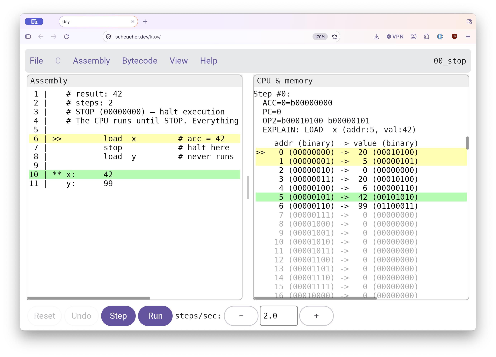
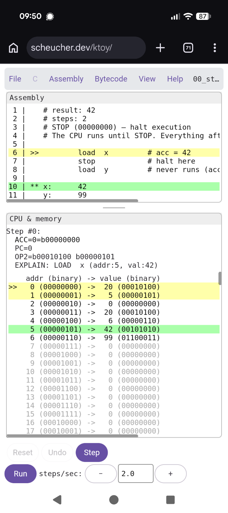

# ktoy

A cross-platform app for the [Toy CPU](https://github.com/freedosproject/toycpu):
an assembler and a simulator you can step through — on the **desktop, the web,
Android and iOS**.

**Try it in the browser: <https://manfredscheucher.github.io/ktoy/>** (desktop, Android, iOS: see [Build & run](#build--run))

<p>
  
  
</p>

The Toy CPU is a minimal 8-bit processor with 256 bytes of memory, one
accumulator, and a program counter. It was built as a FreeDOS learning tool with
a switch-based interface (like an Altair 8800); ktoy keeps the same CPU but lets
you write readable assembly and watch it run. The point is to *see* how a CPU
works: while a program runs, it highlights the current bytecode in memory next to
the matching assembly instruction, and you step through one instruction at a time.

You write assembly (`.toys`); ktoy assembles it to a 256-byte image and runs it.
It also compiles a small C subset and shows C, assembly and memory side by side.
Example programs are built in.

A taste of the syntax:

```
        load  a         # acc = a
        add   b         # acc = a + b
        stop
a:      10              # data goes after stop
b:      20
```

ktoy is in early development. Feedback is very welcome:
[manfred.scheucher@proton.me](mailto:manfred.scheucher@proton.me?subject=ktoy%20feedback&body=hi%20manfred%2C%0A%0A)

## Videos

Tutorials and demos on the Toy CPU (basic instruction set, programs, the C
compiler, and more):

▶ [YouTube playlist](https://www.youtube.com/watch?v=vQxGXtlf5c4&list=PLU1OJ36r4v_c)

## The app

A menu bar (File / C / Assembly / Bytecode / View / Help) over an adaptive 1–3 column view: memory only for
bytecode (`.toyo`), assembly + memory for `.toys`, and C + assembly + memory for a
C program. The columns sit side by side when the window is wide and stack when
it's narrow (View → Layout to force portrait/landscape).

- **C** / **Assembly** — the source, with the current line highlighted.
- **CPU & memory** — the accumulator, program counter and current instruction,
  above a listing of all 256 memory bytes.

A click in any column highlights the same statement across the others. Controls:
Reset, Undo, Step, and Run at an adjustable speed (steps/sec). Right-click a cell or
line (long-press on touch) and choose Edit… or Edit line… to change it. File → Load/Save a program,
Examples browses the built-ins by folder, Help shows the instruction set.

## The code

The shared code is the `composeApp` module (`androidApp` packages it for
Android). The CPU logic lives in `commonMain`:

- `core/ToyCpu.kt` — the CPU core (opcodes, decode/execute). The single source of
  truth for the machine's semantics.
- `core/Assembler.kt` — turns `.toys` assembly into the byte image, with
  line-numbered error messages and did-you-mean hints for typos.
- `core/Machine.kt` — the runnable simulator state: step, step-back (undo), live
  edit, and `.toyo` parsing.
- `ui/` — the Compose screens.
- `core/ExampleSources.kt` — the bundled example programs, **generated** by
  `scripts/gen_example_sources.py`.
- `jvmMain/.../MiniSim.kt` — [minisim](#minisim), a tiny standalone simulator.

## Build & run

```bash
./gradlew :androidApp:assembleDebug        # build the debug APK
./gradlew :composeApp:jvmTest              # run the tests
```

Run scripts per platform (see [`doc/platforms.md`](doc/platforms.md) for details):

```bash
./scripts/runJVM.sh               # desktop
./scripts/runWeb.sh               # web dev-server (http://localhost:8604)
./scripts/runAndroidEmulator.sh   # Android emulator
./scripts/runIosSimulator.sh      # iOS Simulator (macOS + Xcode)
./scripts/runMiniSim.sh program.txt -v   # minisim in the terminal
./scripts/deployPages.sh          # build the web bundle -> gh-pages branch
```

The tests check the final accumulator and step count of every bundled example,
except the I/O ones, which wait for input.

Machine-local scripts for installing on a specific device live in
`_private/scripts/` (not committed).

## minisim

`MiniSim.kt` is a tiny standalone simulator: it reads a bytecode file (Save ->
Bytecode: one integer per line), runs it to STOP and prints every step, with `-v`
also a memory dump. No I/O.

```bash
./scripts/runMiniSim.sh program.txt -v
```

The script needs `kotlinc` and compiles on every run.

## Documentation

The full specification, what was built and why, is in
[`doc/spec.md`](doc/spec.md). Building and running each platform (Android, desktop,
web, iOS), the menus, file I/O and version info are in
[`doc/platforms.md`](doc/platforms.md).

## License & credits

ktoy is MIT-licensed (see [`LICENSE`](LICENSE)).

The original Toy CPU and its instruction set are by Jim Hall (FreeDOS Project): see its
[official page](https://jimhall.itch.io/toy-cpu) and
[source](https://github.com/freedosproject/toycpu).
